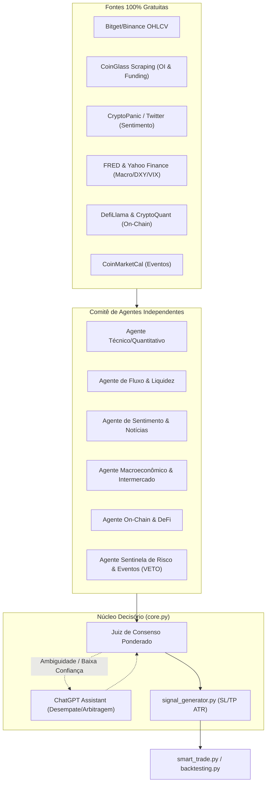

# 🏛️ Cronograma Modular e Diretrizes de Governança - IA Trader

> **Sistema de IA Autônoma para Trading**  
> **Engenharia de Software & Arquitetura de Sistemas**  
> **Status:** Ativo / Em Execução (Atualizado: Arquitetura de Consenso Multi-Agente)

---

## 🏆 A REGRA DE OURO (Golden Rule)

Para garantir que o sistema atinja sua meta de **alta confiabilidade, assertividade > 70% e custo operacional zero de dados**, todo o ciclo de desenvolvimento é regido pela seguinte regra pétrea:

> 🛡️ **REGRA DE OURO DA ENGENHARIA:**  
> **"Nenhum módulo será integrado ou considerado concluído sem cumprir a Tríade de Confiabilidade: (1) Custo Zero de Dados com Fallback Garantido, (2) Validação por Testes e Ausência de Vazamento Temporal (Data Leakage), e (3) Registro de Evidências no Log de Evolução com Ponto de Rollback Seguro."**

### Critérios de Aceite Inflexíveis (Definition of Done - DoD):
1. **Restrição 100% Gratuita (Free Data Mandate):** Proibido o uso de qualquer API paga. Toda chamada externa primária (Bitget, FRED, YFinance) deve conter tratamento de rate-limit e camada de fallback secundária via scraping ou dados em cache.
2. **Consenso Multi-Agente com Poder de Veto:** Nenhum sinal de trade (`buy`/`sell`) é emitido por decisão isolada de um único indicador. A decisão exige consenso ponderado de agentes especialistas independentes, com poder de veto do Agente de Risco.
3. **Métrica Mínima Comprovada:** O pipeline do comitê de decisão e modelo de ensemble deve demonstrar taxa de acerto **superior a 70%** em validação temporal (*Walk-Forward / TimeSeriesSplit*).
4. **Modularidade e Baixo Acoplamento:** Cada agente e submódulo possui interface padronizada (`BaseAgent` com método `evaluate() -> AgentSignal`), facilitando a inclusão ou mutação de agentes.
5. **Rastreabilidade Obrigatória:** Nenhuma linha de código segue para a fase seguinte sem que o [EVOLUTION_LOG.md](file:///home/eudespatricio/ia_trader/EVOLUTION_LOG.md) seja atualizado.

---

## 🏛️ Arquitetura de Decisão: Comitê de Agentes Especialistas

---

| Fase | Módulos Principais | Objetivo Primário | Status |
| :--- | :--- | :--- | :---: |
| **Fase 0** | Governança & Arquitetura | Setup, [CRONOGRAMA_MODULAR.md](file:///home/eudespatricio/ia_trader/CRONOGRAMA_MODULAR.md), [EVOLUTION_LOG.md](file:///home/eudespatricio/ia_trader/EVOLUTION_LOG.md) e Regra de Ouro | 🟢 Concluído |
| **Fase 1** | `data_loader.py`, `data_integrations.py`, `BinanceConnector` | Coleta 100% gratuita multi-exchange (Bitget + Binance), dumps históricos, funding rates e validação cruzada | 🟢 Homologado (23/23 testes) |
| **Fase 2** | `feature_engineering.py`, `market_structure.py` | Features técnicas locais, POI (Order Blocks, FVGs), Zonas de Liquidez, Sweeps e macro D-1 | 🟢 Homologado (15/15 testes) |
| **Fase 3** | `model_trainer.py` | Modelos preditivos (LightGBM/RF), validação temporal purgada com embargo e triple-barrier labeling | 🟢 Homologado (10/10 testes) |
| **Fase 4** | `agents/`, `consensus_judge.py`, `core.py` | Comitê de agentes especialistas, consenso ponderado, veto do Sentinela e R:R assimétrico | 🟢 Homologado (26/26 testes) |
| **Fase 5** | `backtesting.py`, `statistical_rigor.py` | Simulação histórica institucional com custos (Maker 0.02% / Taker 0.06%), DSR e PBO | 🟢 Homologado (16/16 testes) |
| **Fase 6** | `smart_trade.py`, `scripts/run_paper_simulation.py` | Motor de Paper Trading em tempo real, cotas independentes (Scalps 5/dia e Golden Pots 3/dia) | 🟢 Homologado (20/20 testes) |
| **Fase 7** | `performance_tracker.py`, `rollback_guard.py`, `learning_tracker.py`, `scheduler.py` | Telemetria unificada, Circuit Breakers, Memória Episódica, Calibração Adaptativa de Pesos por Regime e Re-treinamento Diário Champion-Challenger | 🟢 Homologado (15/15 testes) |
| **Fase 8** | `flask_interface.py`, `templates/dashboard.html` | Dashboard gráfico Plotly, monitoramento SQLite sem locks, endpoints REST de telemetria e regimes | 🟢 Homologado (38/38 testes) |
| **Fase 9** | `pair_scanner.py`, `voice_commands.py`, `educational_module.py`, `auth_module.py` | Scanner de pares voláteis/delistagens, comandos de voz, módulo educativo, auth e termos | 🟢 Homologado (21/21 testes) |
| **Fase 10** | `launcher.py`, `ia_trader.spec`, `dist/ia_trader/ia_trader` | Simulação ininterrupta 24h, segurança de credenciais e empacotamento standalone | 🟢 Homologado (3/3 testes, total 208/208) |

---

## 🧭 Backlog de Brainstorms & Próximas Evoluções (Pós-Piloto)

Todas as melhorias de experiência visual, refinamento de microestrutura e calibrações de estratégias (como o diagnóstico forense do `GOLDEN_POT` e o benchmark de gráficos estilo TradingView) estão catalogadas e detalhadas em:

👉 **[docs/ROADMAP_BRAINSTORMS.md](file:///home/eudespatricio/ia_trader/docs/ROADMAP_BRAINSTORMS.md)**

Consulte este arquivo para sincronização imediata de contexto em novas sessões de trabalho.

