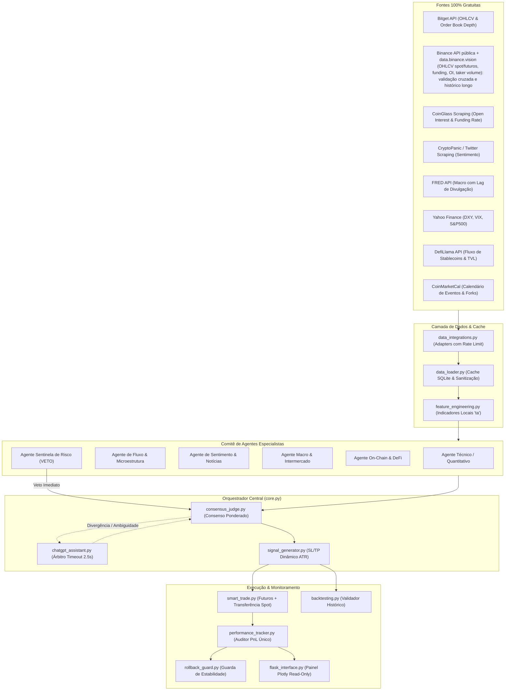

# 🤖 IA Autônoma para Trading (IA Trader)

> **Documento Oficial de Arquitetura, Governança e Manual de Engenharia**  
> **Versão:** 1.0 (Arquitetura Revisada & Blindada)  
> **Meta Operacional:** Assertividade superior a 70% em sinais futuros com conversão de lucros para spot  
> **Restrição Pétrea:** Custo Zero de Dados (100% Free Data & Open-Source)

---

## 📑 Sumário Executivo

O **IA Trader** é um sistema autônomo de inteligência artificial de alta performance desenvolvido para operar no mercado de derivativos/futuros de criptomoedas com alavancagem dinâmica e controle estrito de risco. Os lucros gerados em futuros são transferidos e reinvestidos automaticamente no mercado spot, compondo um portfólio de crescimento patrimonial de longo prazo.

A tomada de decisão não depende de um modelo preditivo monolítico, mas de um **Comitê Deliberativo Multi-Agente** formado por agentes especialistas independentes (Técnico, Fluxo/Liquidez, Sentimento, Macroeconomia, On-Chain e Sentinela de Risco com poder de veto), orquestrados pelo [`core.py`](file:///home/eudespatricio/ia_trader/core.py).

---

## 🛡️ A Regra de Ouro da Engenharia (Golden Rule)

Todo o desenvolvimento, refatoração e expansão deste ecossistema deve seguir rigidamente esta lei:

> ⚖️ **REGRA DE OURO:**  
> **"Nenhum módulo será integrado ou considerado concluído sem cumprir a Tríade de Confiabilidade: (1) Custo Zero de Dados com Fallback Garantido, (2) Validação por Testes e Ausência de Vazamento Temporal (Data Leakage), e (3) Registro de Evidências no Log de Evolução com Ponto de Rollback Seguro."**

### Critérios de Aceite Inflexíveis (Definition of Done - DoD):
1. **Custo Zero de Dados (Free Data Mandate):** Proibido o uso de qualquer API paga ou dependente de planos comerciais. Toda integração primária deve ter fallback via scraping ético ou cache local.
2. **Ausência de Lookahead Bias (Vazamento Temporal):** O cálculo de features e dados macroeconômicos (FRED/CPI) deve utilizar estritamente a data efetiva de divulgação pública (*release date*), evitando falsos positivos em backtests.
3. **Isolamento de Processos e Concorrência:** O motor de negociação e o agendador (`scheduler.py`) operam em processo isolado (*Daemon Worker*) com trava de execução exclusiva (*singleton mutex*). O painel web ([`flask_interface.py`](file:///home/eudespatricio/ia_trader/flask_interface.py)) atua estritamente em modo de leitura/telemetria, impedindo a duplicação acidental de ordens.
4. **Meta de Assertividade > 70%:** O modelo preditivo e o consenso dos agentes só avançam para execução real se comprovarem taxa de acerto $\ge 70\%$ em validação temporal com custos operacionais, funding rate e *slippage* simulados.
5. **Rastreabilidade Contínua:** Nenhuma alteração é promovida sem registro formal no [EVOLUTION_LOG.md](file:///home/eudespatricio/ia_trader/EVOLUTION_LOG.md).

---

## 🏛️ Arquitetura do Sistema: Comitê de Decisão Multi-Agente



---

## 🔧 Correções de Engenharia Aplicadas (Auditoria do Projeto)

| Ponto Auditado | Risco Original | Correção Implementada no Projeto |
| :--- | :--- | :--- |
| **Fontes Inviáveis** | Dependência de Bookmap e Glassnode (sem APIs públicas gratuitas). | **Eliminados.** Substituídos por **CoinGlass (scraping gratuito)** e **Bitget REST/WS público** para liquidez e profundidade de book. |
| **Indicadores Externos** | Uso de `tvdatafeed` (TradingView), sujeito a quebras e bloqueios de IP. | **Eliminado.** Cálculo 100% local com as bibliotecas `ta` e `numpy` direto das velas OHLCV (latência $< 2$ms). |
| **Latência LLM** | Chamada síncrona ao ChatGPT causando *slippage* em trades futuros. | **Timeout estrito de 2.5s.** Caso a LLM demore ou falhe, o orquestrador assume o sinal quantitativo local sem atraso. |
| **Duplicação de Ordens** | Scheduler rodando dentro de múltiplos workers do Flask. | **Separação de Processos:** O `scheduler.py` roda como Daemon independente com *lock* de arquivo; Flask restrito a leitura de banco. |
| **Gargalo de I/O** | Consulta síncrona a 10 APIs a cada vela fechada (atraso de 20s). | **Arquitetura Assíncrona Multi-Cadência:** Dados macro/sentimento são cacheados a cada 30min; no trade, busca-se apenas OHLCV em $< 50$ms. |
| **Conversão Spot** | Compra spot falhava por saldo inexistente (saldo preso em futuros). | **Transferência Automática de Margem:** O `smart_trade.py` realiza a transferência interna (Contract $\rightarrow$ Spot) antes da compra. |
| **Lookahead Bias** | Indicadores macro (FRED) lidos na data de referência e não de publicação. | **Controle de Release Date:** Defasamento obrigatório de dados macroeconômicos no `feature_engineering.py`. |
| **Sequência de Build** | Backtesting programado muito tarde (após gerador de sinais e orquestrador). | **Validação Antecipada:** O `backtesting.py` e validação temporal nascem junto ao `model_trainer.py` para certificar os 70% antes da execução. |

---

## 👥 Especialidades do Comitê de Agentes

Cada agente implementa a interface padrão `BaseAgent` e retorna a estrutura `AgentSignal(direction, confidence, weight, rationale)`:

1. **Agente Técnico/Quantitativo (`TechnicalAgent`):**
   - *Insumos:* Velas OHLCV, RSI, MACD, Médias Móveis (SMA/EMA), ATR, Bandas de Bollinger e Volume.
   - *Responsabilidade:* Identificar tendência primária, sobrecompra/sobrevenda, exaustão e pontos ótimos de entrada.
2. **Agente de Fluxo & Microestrutura (`OrderFlowAgent`):**
   - *Insumos:* Open Interest (OI), Funding Rates e Profundidade do Livro de Ofertas da Bitget.
   - *Responsabilidade:* Confirmar se o movimento tem respaldo de volume institucional ou se é uma armadilha de liquidez (*stop hunt*).
3. **Agente de Sentimento & Notícias (`SentimentAgent`):**
   - *Insumos:* CryptoPanic API, Twitter/X e Fear & Greed Index.
   - *Responsabilidade:* Medir a euforia ou pânico da manada, alertando para topos e fundos emocionais.
4. **Agente Macroeconômico & Intermercado (`MacroCrossAssetAgent`):**
   - *Insumos:* FRED (CPI, Taxas de Juros) e Yahoo Finance (DXY, VIX, S&P500).
   - *Responsabilidade:* Identificar o regime global de liquidez (Risk-On vs Risk-Off) e vetar compras durante choques do dólar (DXY em alta).
5. **Agente On-Chain & DeFi (`OnChainDefiAgent`):**
   - *Insumos:* DefiLlama (Inflow/Outflow de Stablecoins, TVL) e CryptoQuant (Fluxo de mineradores e reservas).
   - *Responsabilidade:* Avaliar a entrada líquida de capital fresco no ecossistema cripto.
6. **Agente Sentinela de Risco (`RiskSentinelAgent` - PODER DE VETO):**
   - *Insumos:* Calendário de Eventos (CoinMarketCal, reuniões FOMC) e Scanner de Delistagem (`pair_scanner.py`).
   - *Responsabilidade:* **Poder de Veto Incondicional.** Caso haja evento de alto impacto iminente ($< 30$ min) ou risco regulatório/delistagem, cancela qualquer operação e força `HOLD`.

---

## 📁 Estrutura do Repositório

```text
/ia_trader
├── README.md                 # Guia mestre e documentação de arquitetura (este arquivo)
├── CRONOGRAMA_MODULAR.md     # Planejamento das 10 fases e critérios de avanço
├── EVOLUTION_LOG.md          # Registro contínuo de auditoria e entregas
├── requirements.txt          # Dependências Python homologadas
├── core.py                   # Orquestrador Central (Maestro do Sistema)
├── backtesting.py            # Validador de performance histórica e custos
├── smart_trade.py            # Executor no mercado futuro e conversor spot
├── chatgpt_assistant.py      # Árbitro LLM com timeout de 2.5s para desempate
├── flask_interface.py        # Dashboard web responsivo (Plotly, Read-Only)
├── scheduler.py              # Daemon assíncrono de rotinas e tarefas agendadas
├── learning_tracker.py       # Memória e refinamento de pesos dos agentes
├── rollback_guard.py         # Monitor de estabilidade e rollback automático
├── performance_tracker.py    # Fonte única de métricas financeiras (PnL, Drawdown)
├── pair_scanner.py           # Scanner de pares voláteis e alerta de delistagem
├── /agents                   # Módulos independentes do Comitê de Agentes
│   ├── base_agent.py         # Classe abstrata com contrato AgentSignal
│   ├── technical_agent.py    # Agente Técnico / Quantitativo
│   ├── orderflow_agent.py    # Agente de Fluxo & Liquidez
│   ├── sentiment_agent.py    # Agente de Sentimento & Notícias
│   ├── macro_agent.py        # Agente Macroeconômico & Intermercado
│   ├── onchain_agent.py      # Agente On-Chain & DeFi
│   ├── risk_sentinel.py      # Agente Sentinela de Risco (com veto)
│   └── consensus_judge.py    # Algoritmo de deliberação ponderada
├── /data
│   ├── data_integrations.py  # Conectores externos 100% gratuitos (Adapters)
│   ├── data_loader.py        # Gerenciador de cache local SQLite e ingestão
│   └── feature_engineering.py# Engenharia de features local (ta, ATR, lags)
├── /models                   # Modelos treinados (.pkl, .joblib)
├── /logs                     # Logs rotativos estruturados via Loguru
├── /datasets                 # Datasets históricos locais (Parquet/CSV)
├── /config                   # Configurações de pares, thresholds e risco (.yaml)
├── /tests                    # Testes unitários e de integração (pytest)
└── /templates                # Templates HTML para a interface Flask
```

---

## 📅 Roadmap das 10 Fases Modulares

```mermaid
flowchart LR
    F0["0. Governança ✅"] --> F1["1. Pipeline Dados"]
    F1 --> F2["2. Features & TA"]
    F2 --> F3["3. ML & Backtest (>70%)"]
    F3 --> F4["4. Comitê de Agentes"]
    F4 --> F5["5. Execução Futuros/Spot"]
    F5 --> F6["6. Telemetria & Rollback"]
    F6 --> F7["7. Dashboard & Auth"]
    F7 --> F8["8. Scanner & Auxiliares"]
    F8 --> F9["9. Hardening 24h"]
    F9 --> F10["10. Build .EXE"]
```



1. **Fase 0: Setup, Arquitetura & Governança (🟢 Homologado):** Especificação, [CRONOGRAMA_MODULAR.md](file:///home/eudespatricio/ia_trader/CRONOGRAMA_MODULAR.md), [EVOLUTION_LOG.md](file:///home/eudespatricio/ia_trader/EVOLUTION_LOG.md) e Regra de Ouro.
2. **Fase 1: Ingestão de Dados Gratuitos (🟢 Homologado - 23/23 testes):** Conectores Bitget, Binance (API pública e data.binance.vision), CoinGlass, FRED, YFinance, CryptoPanic, DefiLlama com cache local SQLite multi-cadência em modo WAL.
3. **Fase 2: Engenharia de Features & Estrutura (🟢 Homologado - 15/15 testes):** Indicadores `ta` locais, ATR, volume profile, Order Blocks (OB), Fair Value Gaps (FVG), Zonas de Liquidez (BSL/SSL), Sweeps e codificação macro D-1 contra *lookahead bias*.
4. **Fase 3: Treinamento de Modelos & Validação Temporal (🟢 Homologado - 10/10 testes):** Validação temporal purgada com embargo, LightGBM / Random Forest e triple-barrier labeling.
5. **Fase 4: Comitê de Agentes & Orquestrador (🟢 Homologado - 26/26 testes):** 6 agentes especialistas independentes, juiz de consenso ponderado com precedência de veto do Sentinela de Risco e relações assimétricas R:R $\ge 2.5:1$.
6. **Fase 5: Backtesting Institucional com Custos (🟢 Homologado - 16/16 testes):** Modelagem estrita de taxas maker (0.02%), taker (0.06%), slippage, Deflated Sharpe Ratio (DSR), PBO e carry delta-neutro.
7. **Fase 6: Motor de Execução Smart Trade (🟢 Homologado - 20/20 testes):** Operação estrita em Paper Trading (zero risco real), cotas diárias independentes (Scalp 5/dia e Golden Pots 3/dia) e saídas parciais escalonadas (TP1 50% + Breakeven + TP2).
8. **Fase 7: Telemetria, Aprendizado & Guardião (🟢 Homologado - 15/15 testes):** Rastreio de PnL único, Circuit Breakers de Drawdown (10%) e Cooldown de perdas (4 stops), Memória Episódica, Calibração Dinâmica de Pesos por Regime e Re-treinamento Diário Champion-Challenger.
9. **Fase 8: Painel Web, Autenticação & Legal (🟢 Homologado - 38/38 testes):** Interface Plotly desacoplada (read-only), JWT, telemetria em tempo real, monitoramento de regimes e termos de uso.
10. **Fase 9: Módulos de Apoio & Governança (🟢 Homologado - 21/21 testes):** Scanner de volatilidade e delistagens (`pair_scanner.py`), controle de voz local (`voice_commands.py`), explicações didáticas de sinais (`educational_module.py`) e RBAC com planos de assinatura (`auth_module.py`).
11. **Fase 10: Hardening 24h & Empacotamento Standalone (🟢 Homologado - 3/3 testes, 208/208 global):** Simulação ininterrupta multithread, recuperação supervisionada, launcher unificado (`launcher.py`) e executável standalone gerado via PyInstaller (`dist/ia_trader/ia_trader`).

---


## 🚀 Como Executar o Sistema

### 1. Pré-requisitos
- Python 3.10 ou superior (para execução via código-fonte)
- Ou utilizar o binário standalone compilado (`dist/ia_trader/ia_trader`)

### 2. Execução Unificada via Launcher
```bash
# Executa todos os subsistemas integrados (Trader + Agendador + Painel Web):
.venv/bin/python launcher.py --port 5000

# Ou em modo Headless (sem interface web, apenas trading e agendador em background):
.venv/bin/python launcher.py --headless

# Ou utilizando diretamente o binário standalone compilado:
./dist/ia_trader/ia_trader --port 5000
```

### 3. Execução da Suíte Completa de Testes
```bash
.venv/bin/pytest -v
# Resultado: 208 passed in 72s (100% Green)
```

---

*Manual elaborado pelo Engenheiro de Software Sênior. Todas as correções, módulos e blindagens estão ativos.*
