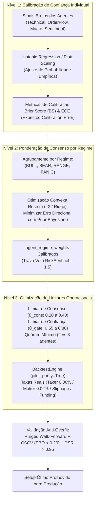
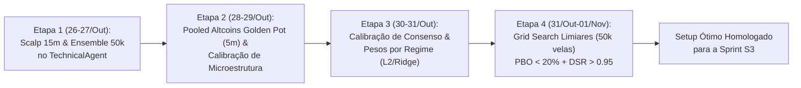

# Protocolo de Calibração e Validação de Agentes em Backtest (S2)

> **Documento de Engenharia & Protocolo Experimental — Sprint S2 (26/Out a 01/Nov/2026)**  
> **Status:** 🟡 **PLANEJAMENTO ATIVO**  
> **Responsáveis:** Antigravity AI / Quantitative Research & Engineering Team  
> **Contexto:** Homologação do Ecossistema IA Trader para Lucratividade Real (Prazo: 10/Dez/2026)

---

## 1. Visão Geral e Justificativa Científica

Nas auditorias operacionais da S1 e nos primeiros testes empíricos da S2, identificamos dois gargalos fundamentais na tomada de decisão do comitê de agentes:
1. **Descalibração de Probabilidades / Confiança (*Overconfidence / Underconfidence*):**  
   Um sinal com `confidence = 0.75` gerado por um agente (seja por regras heurísticas ou pelo modelo tabular LightGBM/RF) frequentemente não corresponde a uma taxa de acerto real de 75% no mercado ao vivo. Em regimes laterais com ruído (`SIDEWAYS_RANGE`), os agentes exibem sobreconfiança, enquanto em rompimentos voláteis exibem subconfiança ou atraso (*late entry*).
2. **Efeito Penhasco nos Limiares de Decisão (*Cliff Effect*):**  
   A varredura empírica em 6.000 velas 1h (BTCUSDT) evidenciou que limiares rígidos de confiança (ex: subida brusca para `0.80` pelo `RollbackGuard`) congelam a amostragem de trades (-50% a -60% no volume) e paradoxalmente reduzem o Win Rate (41,3% vs 43,3% em 0.65/0.75), pois forçam entradas tardias no fim do movimento.
3. **Risco de Mineração de Dados (*Data-Snooping & Backtest Overfitting*):**  
   Simplesmente rodar um Grid Search em dados passados e escolher a combinação de pesos e thresholds com o maior lucro líquido histórico levaria inevitavelmente a um modelo sobreajustado (*overfitted*), que falharia miseravelmente em produção.

**Objetivo da S2:**  
Desenvolver, especificar e executar um protocolo rigoroso de calibração em backtest que:
- Calibre probabilisticamente as saídas de confiança de cada agente.
- Otimize a matriz de ponderação do consenso (`agent_regime_weights`) por regime de mercado.
- Determine os limiares ótimos de consenso e gate de confiança ($\theta_{\text{consensus}}, \theta_{\text{gate}}$) por estratégia e timeframe.
- Garanta **blindagem matemática contra overfitting** via Purged Walk-Forward com Embargo, Combinatorially Symmetric Cross-Validation (CSCV) com cálculo de **PBO < 20%** e **Deflated Sharpe Ratio (DSR > 0.95)**.

---

## 2. Os Três Níveis de Calibração do Comitê Multi-Agente

A calibração do sistema é estruturada em uma hierarquia de três camadas complementares:

### 2.1. Nível 1: Calibração de Confiança Individual (*Probability Calibration*)
- **Conceito:** A confiança $c_i \in [0.5, 1.0]$ emitida pelo agente $i$ deve representar fielmente a frequência relativa de vitórias empíricas daquele sinal:
  $$P(\text{Trade Vencedor} \mid \text{Confidence} = p) \approx p$$
- **Métricas Quantitativas:**
  - **Brier Score (BS):**
    $$\text{BS} = \frac{1}{N} \sum_{t=1}^{N} (c_{i,t} - y_t)^2, \quad y_t \in \{0, 1\}$$
    Mede a precisão probabilística absoluta das previsões.
  - **Expected Calibration Error (ECE):**
    $$\text{ECE} = \sum_{m=1}^{M} \frac{|B_m|}{N} \left| \text{acc}(B_m) - \text{conf}(B_m) \right|$$
    Onde os sinais são particionados em $M=10$ bins de confiança uniforme. O objetivo é $\text{ECE} \le 0.05$ (erro de calibração $\le 5\%$).
  - **Reliability Diagrams:** Curvas de confiabilidade plotando $\text{conf}(B_m)$ vs $\text{acc}(B_m)$ para diagnosticar desvios de sobre/subconfiança.
- **Técnicas de Calibração Pós-Hoc:**
  - **Platt Scaling:** Regressão logística na saída de probabilidade dos agentes baseados em ML (`TechnicalAgent` LGBM/RF).
  - **Isotonic Regression:** Ajuste monótono não-paramétrico para agentes baseados em regras e microestrutura (`OrderFlowAgent` / `TapeReadingAgent`).

### 2.2. Nível 2: Ponderação de Consenso por Regime de Mercado (*Regime Ensemble Optimization*)
- **Problema Atual:** O `LearningTracker` atualiza os pesos com um multiplicador heurístico linear:
  $$\text{multiplier} = \text{clip}(1.0 + (\text{acc} - 0.50) \times 1.5, \, 0.40, \, 1.80)$$
  Embora funcional, ele não resolve a correlação mútua entre agentes (colinearidade) nem encontra a fronteira eficiente de votos.
- **Formulação Otimizada (Regressão Restrita L2 com Shrinkage Bayesiano):**
  Para cada regime $k \in \{\text{BULL\_TREND}, \text{BEAR\_TREND}, \text{SIDEWAYS\_RANGE}, \text{HIGH\_VOLATILITY\_PANIC}\}$:
  $$\min_{\mathbf{w}_k} \sum_{t \in \mathcal{T}_k} \ell \left( \sum_{i=1}^{M} w_{k,i} \cdot s_{i,t}, \; y_t \right) + \lambda \|\mathbf{w}_k - \mathbf{w}_{\text{prior}}\|_2^2$$
  Sujeito a:
  $$w_{k,i} \ge 0, \quad \sum_{i=1}^{M} w_{k,i} = 1.0, \quad w_{\text{RiskSentinel}} = \text{VETO (Prioritário)}$$
  Onde:
  - $s_{i,t} \in \{-1, 0, +1\} \times c_{i,t}$ é o voto direcional ponderado pela confiança calibrada do agente $i$.
  - $y_t \in \{-1, +1\}$ é a direção rentável realizada líquida de custos de transação.
  - $\mathbf{w}_{\text{prior}}$ é o peso pré-estabelecido a priori (ancoragem bayesiana para evitar colapso de pesos com poucas amostras).
  - $\lambda$ é o hiperparâmetro de regularização Ridge (shrinkage).

### 2.3. Nível 3: Otimização de Limiares Operacionais (*Decision Gates & Execution*)
- **Parâmetros a Otimizar:**
  1. **Limiar de Consenso ($\theta_{\text{consensus}}$):** Varredura em $[0.20, 0.25, 0.30, 0.35, 0.40]$ no `ConsensusJudge`.
  2. **Gate de Confiança Mínima ($\theta_{\text{gate}}$):** Varredura de $[0.55, 0.60, 0.65, 0.70, 0.75, 0.80]$ com resolução de $0.05$.
  3. **Quórum Mínimo Direcional ($Q$):** $Q \in \{2, 3\}$ agentes obrigatórios no mesmo sentido (eliminando trades com votos solitários de alto peso).
  4. **Perfil de Take Profit e Stop Loss por Estratégia:**
     - Scalp (15m): SL 0.9x ATR | TP1 1.2x | TP2 2.0x | TP3 3.6x ATR.
     - Directional (1h): SL 1.0x ATR | TP1 1.8x | TP2 3.0x | TP3 5.0x ATR.
     - Golden Pot (5m): SL 1.5x ATR | TP1 2.0x | TP2 3.5x | TP3 6.5x ATR.

---

## 3. Protocolo de Validação em Backtest Anti-Overfitting

Para assegurar que o setup selecionado seja genuinamente robusto e não fruto de garimpo estatístico (*data snooping*), estabelecemos 4 travas matemáticas inegociáveis:

### 3.1. Purged Walk-Forward com Embargo (PWF-CV)
- **Janela de Treino/Calibração:** 12 meses (ou 8.760 velas de 1h / 35.000 velas de 15m).
- **Janela de Teste Fora da Amostra (OOS):** 3 meses rolantes.
- **Purga de Posições Cruzadas (*Cross-Boundary Purge*):**
  Trades abertos na janela de calibração que terminariam dentro da janela de teste são expurgados de ambos os conjuntos para eliminar vazamento de dependência temporal (*overlap leak*).
- **Embargo Temporal:** Intervalo de segurança de 7 a 10 dias de mercado entre a partição de calibração e a partição OOS, anulando autocorrelação de retornos e persistência de microestrutura.

### 3.2. Combinatorially Symmetric Cross-Validation (CSCV) & PBO
- **Conceito (Bailey, Borwein, López de Prado & Zhu, 2017):**
  A série temporal completa é particionada em $S=10$ fatias contíguas. Geram-se todas as $\binom{S}{S/2} = \binom{10}{5} = 252$ combinações de partição (5 subperíodos para treino, 5 para teste).
- **Probability of Backtest Overfitting (PBO):**
  Calcula a frequência com que o setup classificado como $n^\circ 1$ no treino (*In-Sample*) tem performance abaixo da mediana no teste (*Out-Of-Sample*).
- **Critério de Aceite da S2:**
  $$\text{PBO} < 0.20 \quad (\le 20\%)$$
  Se $\text{PBO} \ge 0.20$, o setup é **rejeitado imediatamente por excesso de parametrização**.

### 3.3. Deflated Sharpe Ratio (DSR) e Rastreamento de Ensaios
- Todos os testes de grade ou otimização bayesiana registram seus ensaios em `datasets/reports/trial_log.csv` através da infraestrutura existente em `statistical_rigor.py`.
- O Sharpe Ratio obtido é deflacionado considerando o número total de tentativas $N$:
  $$\text{DSR} = Z\left( \frac{(\widehat{\text{SR}} - \text{SR}^*) \sqrt{T - 1}}{\sqrt{1 - \widehat{\gamma}_3 \widehat{\text{SR}} + \frac{\widehat{\gamma}_4 - 1}{4} \widehat{\text{SR}}^2}} \right)$$
  Onde $\text{SR}^* = \sqrt{2 \ln N} \left( (1 - \gamma)\Phi^{-1}(1 - 1/N) + \gamma \Phi^{-1}(1 - 1/(N e)) \right)$.
- **Critério de Aceite da S2:**
  $$\text{DSR} > 0.95 \quad (p\text{-valor} < 0.05)$$

### 3.4. Paridade Estrita com o Piloto (`pilot_parity=True`)
O backtest DEVE rodar obrigatoriamente através do `BacktestEngine(pilot_parity=True)`, garantindo:
- Custos realistas de execução: Taker Fee Bitget $0.06\%$ + Slippage de mercado $0.02\%$ na entrada; Maker Fee $0.02\%$ + Slippage maker $0.01\%$ nas ordens limite de TP1/TP2/TP3.
- Funding rate horário ou a cada 8h deduzido em ticks reais da tabela `funding_rates`.
- Parciais estritas de saída: $40\%$ no TP1 com avanço imediato para Breakeven; $30\%$ no TP2 com acionamento de Trailing Stop; $30\%$ no TP3.
- Teto de margem agregada ($85\%$) e máximo de posições concorrentes ($5$ simultâneas).

---

## 4. Função Objetivo Institucional (*Institutional Fitness Function*)

Para evitar funções objetivo ingênuas (como lucro bruto ou Sharpe isolado), definimos uma função objetivo composta e com penalidades estritas de risco:

$$\mathcal{F} = \text{Sharpe}_{\text{OOS}} \times \left( 1 - \frac{\text{MaxDD}_{\text{OOS}}}{0.10} \right) \times \mathbb{E}[R]_{\text{net}} \times (1 - \text{ECE}_{\text{ensemble}}) \times \sqrt{\min\left(1.0, \, \frac{N_{\text{trades}}}{50}\right)}$$

### Restrições Rígidas (*Hard Gates*):
| Métrica | Limiar Mínimo Exigido | Justificativa |
| :--- | :--- | :--- |
| **Expectativa Matemática $\mathbb{E}[R]$** | $\ge +0.25R$ líquido de taxas | Garante assimetria positiva sustentável após atrito de execução. |
| **Profit Factor (OOS)** | $\ge 1.50$ | Blindagem contra clusters de perdas consecutivas. |
| **Max Drawdown (OOS)** | $\le 6.0\%$ | Preservação estrita do capital da banca institucional. |
| **Volume de Trades** | $\ge 30$ trades / trimestre | Amostragem estatística suficiente para validade do teste t. |
| **Win Rate** | $\ge 45\%$ | Com R:R $\ge 1.8$, garante estabilidade psicológica e de margem. |
| **PBO (CSCV)** | $< 20.0\%$ | Certeza matemática de não-sobreajuste. |
| **DSR** | $> 0.95$ | Significância estatística contra mineração de dados. |

---

## 5. Aproveitamento das Ferramentas Homologadas do Projeto (Teste Abrangente de Sexta-Feira)

Em vez de criar uma ferramenta CLI paralela ou redundante, o protocolo de calibração alavanca **100% da infraestrutura quantitativa já construída e validada na auditoria de 24/Out (Sexta-Feira)**:

1. **Harness A/B e Purged Walk-Forward com Embargo:**  
   [`scripts/ab_consensus_experiment.py`](file:///home/eudespatricio/ia_trader/scripts/ab_consensus_experiment.py)  
   Já implementa:
   - Partição temporal com Purged Walk-Forward (60% In-Sample / 40% Holdout com embargo estrito de 10 dias e purga de posições cruzadas).
   - Simulação determinística barra a barra no fechamento ($t$) com entrada na abertura ($t+1$).
   - Custos institucionais reais (Taker 0.06% + Slippage 0.02% por perna, funding rate histórico da tabela `funding_rates`).
   - Métricas de Deflated Sharpe Ratio (DSR) e bootstrap de blocos pareados.

2. **Auditoria de Paridade Estrita Backtest x Paper (Piloto):**  
   [`scripts/parity_audit.py`](file:///home/eudespatricio/ia_trader/scripts/parity_audit.py) & [`tests/parity/test_backtest_vs_paper_parity.py`](file:///home/eudespatricio/ia_trader/tests/parity/test_backtest_vs_paper_parity.py)  
   Garante paridade 1:1 absoluta ("laranjas com laranjas") entre o que é calibrado no backtest e o que é executado no motor ao vivo (`PaperTradingEngine`).

3. **Pipeline de Machine Learning e Datasets Amplos (50k Velas):**  
   [`model_trainer.py`](file:///home/eudespatricio/ia_trader/model_trainer.py)  
   Otimizado para o hardware local WSL (CPU i7-11800H, `n_jobs=8`), processando 50.000 candles de 1h (~5,7 anos) em 1,5s com validação out-of-sample e extração de feature importance.

4. **Motor de Backtest e Rigor Estatístico:**  
   [`backtesting.py`](file:///home/eudespatricio/ia_trader/backtesting.py) & [`statistical_rigor.py`](file:///home/eudespatricio/ia_trader/statistical_rigor.py)  
   Execução vetorial com `pilot_parity=True` (respeitando a Smart Trade Exit Ladder: TP1/TP2/TP3 + Breakeven + Trailing Stop) e registro automático de tentativas no `trial_log.csv` para auditoria de overfitting.

5. **Aprendizado Contínuo e Matriz de Regime ao Vivo:**  
   [`learning_tracker.py`](file:///home/eudespatricio/ia_trader/learning_tracker.py) & [`consensus_judge.py`](file:///home/eudespatricio/ia_trader/consensus_judge.py)  
   Registro de cada decisão e desfecho em `agent_learning_memory` e recalibração de pesos de consenso por regime consumida diretamente pelo `TradingCore`.

---

## 6. Cronograma Integrado com a Rotina Prevista da Sprint S2 (26/Out a 01/Nov)

A calibração dos agentes não é um processo isolado: ela se encaixa com precisão nos **5 entregáveis já planejados para a rotina da S2**, aproveitando cada etapa para refinar os parâmetros do comitê:

| Etapa | Janela | Foco Tático na Rotina da S2 | Ferramentas Existentes Utilizadas | Entregável / Meta Quantitativa |
| :--- | :--- | :--- | :--- | :--- |
| **Etapa 1** | **26 a 27/Out** | **1. Migração do Scalp (`3m` → `15m`):** Redução do peso de taxas de `0,79R` para `0,16R` e ganho de expectativa $\mathbb{E}[R] > +0,20R$. **2. Conexão do Ensemble LGBM+RF 50k:** Conectar modelos treinados ao vivo no `TechnicalAgent` para `DIRECTIONAL (1h)`. | [`model_trainer.py`](file:///home/eudespatricio/ia_trader/model_trainer.py) [`agents/technical_agent.py`](file:///home/eudespatricio/ia_trader/agents/technical_agent.py) [`scripts/run_paper_simulation.py`](file:///home/eudespatricio/ia_trader/scripts/run_paper_simulation.py) | Modelos 50k gerando sinais ao vivo com acurácia validada $\ge 70\%$ e Scalp rodando em 15m. |
| **Etapa 2** | **28 a 29/Out** | **3. Painel Pooled Multi-Altcoin (5m):** Unificar ~20 pares de Golden Pot em dataset consolidado (~25k velas). **4. Recalibração de Microestrutura:** Ajustar `FlowScore` e reversão por absorção institucional (`absorption_*`) com dados reais de `microstructure.db`. | [`scripts/microstructure_collector.py`](file:///home/eudespatricio/ia_trader/scripts/microstructure_collector.py) [`agents/tape_reading_agent.py`](file:///home/eudespatricio/ia_trader/agents/tape_reading_agent.py) [`agents/golden_pot_agent.py`](file:///home/eudespatricio/ia_trader/agents/golden_pot_agent.py) | Microestrutura eliminando entradas contra fluxo e Golden Pot com dados pooled de treino. |
| **Etapa 3** | **30 a 31/Out** | **Otimização de Consenso & Regime Weights:** Atualizar matriz de pesos em `learning_tracker.py` usando regressão regularizada com prior bayesiano sobre os sinais emitidos nas 50k velas, preservando veto do Sentinela (`1.5`). | [`learning_tracker.py`](file:///home/eudespatricio/ia_trader/learning_tracker.py) [`consensus_judge.py`](file:///home/eudespatricio/ia_trader/consensus_judge.py) [`scripts/ab_consensus_experiment.py`](file:///home/eudespatricio/ia_trader/scripts/ab_consensus_experiment.py) | Tabela `agent_regime_weights` preenchida com pesos calibrados de menor variância direcional. |
| **Etapa 4** | **31/Out a 01/Nov** | **5. Grid Search de Limiares (50k Velas) & Homologação:** Varredura multivariada de $\theta_{\text{gate}}$ em degraus de 0.05 (`0.60, 0.65, 0.70, 0.75, 0.80`) e $\theta_{\text{consensus}}$ (`0.25 a 0.35`) via harness A/B offline com paridade total. | [`scripts/ab_consensus_experiment.py`](file:///home/eudespatricio/ia_trader/scripts/ab_consensus_experiment.py) [`scripts/parity_audit.py`](file:///home/eudespatricio/ia_trader/scripts/parity_audit.py) [`statistical_rigor.py`](file:///home/eudespatricio/ia_trader/statistical_rigor.py) | **Setup Vencedor Identificado:** $\text{PBO} < 20\%$, $\text{DSR} > 0.95$, $\text{PF} \ge 1.50$, transição fluida para S3 (Classificador de Regime). |

---

## 7. Rastreabilidade e Conexões do Projeto

- **Roadmap Master:** [`docs/ROADMAP_BRAINSTORMS.md`](file:///home/eudespatricio/ia_trader/docs/ROADMAP_BRAINSTORMS.md)
- **Histórico Evolutivo:** [`EVOLUTION_LOG.md`](file:///home/eudespatricio/ia_trader/EVOLUTION_LOG.md)
- **Motor de Backtest:** [`backtesting.py`](file:///home/eudespatricio/ia_trader/backtesting.py)
- **Árbitro de Consenso:** [`consensus_judge.py`](file:///home/eudespatricio/ia_trader/consensus_judge.py)
- **Aprendizado Contínuo:** [`learning_tracker.py`](file:///home/eudespatricio/ia_trader/learning_tracker.py)
- **Rigor Estatístico e PBO:** [`statistical_rigor.py`](file:///home/eudespatricio/ia_trader/statistical_rigor.py)
- **Guardião de Risco:** [`rollback_guard.py`](file:///home/eudespatricio/ia_trader/rollback_guard.py)
